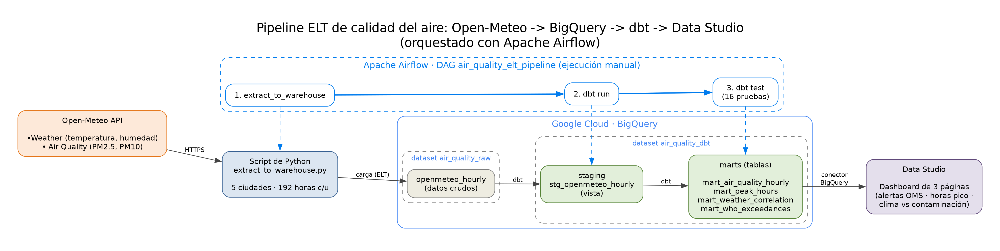

# Pipeline ELT de calidad del aire y clima en la nube

**Environmental & Smart City Analytics** · Proyecto 5 Análisis de Datos

Pipeline de datos moderno con arquitectura **ELT** que monitorea la calidad del aire y clima en 5 grandes ciudades para la toma de decisiones. Extrae datos de la API Open-Meteo, los carga a BigQuery, se tranforman dentro del warehouse con dbt, orquesta la ejecución con Apahce Airflow y los presenta en un dashboard de Data Studio.

- **Ciudades:** Ciudad de México, Delhi, Los Ángeles, São Paulo y Madrid.
- **Variables:** PM2.5, PM10, temperatura y humedad relativa, por hora.
- **Ventana de datos:** los últimos 7 días
- **Dashboard:** [Ver dashboard en Data Studio](https://datastudio.google.com/reporting/fbab7b1b-e32b-4397-878c-b3f255bbb960)

## Preguntas de negocio

| Pregunta | Modelo dbt que la responde | Dashboard |
| --- | --- | --- |
| ¿Cuáles son las horas pico del día con peor calidad del aire por ciudad? | `mart_peak_hours` | Página 2 del dashboard|
| ¿Existe correlación entre temperatura o humedad y la concentración de PM2.5 y PM10? | `mart_weather_correlation` | Página 3 del dashboard|
| ¿Qué ciudades superaron los límites de la OMS en la última semana? | `mart_who_exceedances` | Página 1 del dashboard|

Un cuarto modelo, `mart_air_quality_hourly`, deja los promedios por ciudad, fecha local y hora local como tabla base para análisis posterior.

## Arquitectura



El flujo sigue el patrón **ElT**: los datos se cargan en bruto y se transforman dentro del warehouse.

1. **Extracción (Python).** `scripts/extract_to_warehouse.py` consulta dos endpoints de Open-Meteo por ciudad: el de clima (temperatura y humedad) y el de calidad del aire (PM2.5 y PM10). Une ambos por hora y obtiene 192 filas por ciudad (7 días anteriores y el día en curso, en UTC).
2. **Carga (BigQuery, capa cruda).** La tabla `air_quality_raw.openmeteo_hourly` guarda los datos tal como llegan, sin transformaciones. Cada ejecución reemplaza la tabla (`WRITE_TRUNCATE`).
3. **Transformación (dbt Core).** Dentro de BigQuery, el modelo de *staging* limpia y tipifica los datos (vista) y cuatro *marts* los agregan para negocio (tablas), en el dataset `air_quality_dbt`. `dbt test` ejecuta 16 pruebas de calidad.
4. **Orquestación (Apache Airflow).** El DAG `air_quality_elt_pipeline` encadena tres tareas: extracción, `dbt run` y `dbt test`. Se ejecuta de forma manual desde la interfaz local.
5. **Visualización (Data Studio).** El dashboard se conecta directamente a los marts en BigQuery.

En el diagrama, Airflow aparece como una banda que encuelce las tareas y no como un paso del flujo de datos, porque orquesta la ejecución mientras no mueve datos.

## Herramientas

| Capa | Herramienta | Versión |
| --- | --- | --- |
| Entorno de desarrollo | WSL2 con Ubuntu y VSCode | |
| Extracción | Python, requests, pandas, pyarrow | Python 3.14 · pandas 3.1.0 |
| Data warehouse | Google BigQuery (google-cloud-bigquery) | 3.46.2 |
| Transformación y calidad | dbt Core con dbt-bigquery | 1.12.6 · 1.12.1 |
| Orquestación | Apache Airflow (modo standalone) | 3.2.0 · Python 3.12 |
| Business intelligence | Data Studio (anteriormente Looker Studio) | |
| Diagrama | Graphviz y la librería graphviz de Python | 14.1 · 0.21 |

Cada herramienta usa su propio entorno virtual de Python. Las versiones exactas se encuentran en los archivos `requirements-*.txt`.

## Estructura del proyecto

Esta carpeta vive dentro del repositorio [`pochoav/proyectos_analisis_de_datos`](https://github.com/pochoav/proyectos_analisis_de_datos), que reúne varios proyectos de portafolio.

```text
proyecto_5_elt_pipeline_entrega/
├── dashboard/
│   └── dashboard_link.txt            # Enlace al dashboard de Data Studio
├── dbt_project/
│   ├── models/
│   │   ├── staging/
│   │   │   ├── sources.yml           # Declaración de la tabla cruda de BigQuery
│   │   │   ├── schema.yml            # Pruebas del modelo de staging
│   │   │   └── stg_openmeteo_hourly.sql
│   │   └── marts/
│   │       ├── schema.yml            # Pruebas de los marts
│   │       ├── mart_air_quality_hourly.sql
│   │       ├── mart_peak_hours.sql
│   │       ├── mart_weather_correlation.sql
│   │       └── mart_who_exceedances.sql
│   ├── tests/                        # Pruebas de rangos imposibles (SQL)
│   │   ├── assert_temperature_in_valid_range.sql
│   │   ├── assert_humidity_in_valid_range.sql
│   │   └── assert_pm_not_negative.sql
│   └── dbt_project.yml
├── orchestration/
│   └── dags/
│       └── airflow_pipeline.py       # DAG de Airflow
├── scripts/
│   ├── extract_to_warehouse.py       # Ingesta API -> BigQuery
│   └── generate_architecture_diagram.py
├── architecture_diagram.png
├── .env.example                      # Plantilla para variables de entorno
├── requirements-extract.txt
├── requirements-dbt.txt
├── requirements-airflow.txt
├── requirements-diagram.txt
└── README.md
```

Fuera del repositorio quedan el archivo `~/.dbt/profiles.yml` (conexión de dbt), el archivo `.env` con tus valores reales y los entornos virtuales en `~/venvs/`.

## Requisitos previos

| Requisito | Para qué se usa |
| --- | --- |
| Linux, o Windows con **WSL2 y Ubuntu** | Airflow no funciona de forma nativa en Windows |
| Cuenta de **Google Cloud** con un proyecto | BigQuery (los volúmenes de este proyecto son de unos miles de filas, con consumo mínimo) |
| **Google Cloud CLI** (`gcloud` y `bq`) | Autenticación y comandos de BigQuery. [Guía de instalación](https://cloud.google.com/sdk/docs/install) |
| **Git** y **curl** | Clonar el repositorio e instalar `uv` |
| **uv** | Crear entornos virtuales con la versión de Python necesaria |
| **Graphviz** (opcional) | Solo para regenerar el diagrama de arquitectura |

Instalación de `uv`:

```bash
curl -LsSf https://astral.sh/uv/install.sh | sh
source $HOME/.local/bin/env
```

## Instalación y despliegue

### 1. Clonar el repositorio

El proyecto está en una subcarpeta de un repositorio que reúne varios proyectos de portafolio:

```bash
git clone https://github.com/pochoav/proyectos_analisis_de_datos.git
cd proyectos_analisis_de_datos/proyecto_5_elt_pipeline_entrega
```

Se recomienda clonarlo dentro del sistema de archivos de Linux (por ejemplo, en `~/proyectos`). Todos los comandos siguientes se ejecutan desde la carpeta `proyecto_5_elt_pipeline_entrega`.

### 2. Configurar Google Cloud

1. Crea un proyecto en [Google Cloud](https://cloud.google.com/free) y comprueba que la API de BigQuery esté habilitada. El ID de un proyecto es único, así que usa el tuyo en lugar de `air-quality-elt`.
2. Inicia sesión y selecciona el proyecto:

```bash
gcloud auth login
gcloud config set project air-quality-elt
gcloud auth application-default login
```

El último comando guarda las credenciales que usan Python y dbt, sin llaves ni contraseñas en el repositorio.

3. Crea el dataset de la capa cruda. La ubicación no se puede cambiar después:

```bash
bq --location=US mk --dataset air-quality-elt:air_quality_raw
```

El dataset `air_quality_dbt`, donde dbt crea sus modelos, se crea automáticamente en la primera ejecución.

### 3. Variables de entorno

```bash
cp .env.example .env
```

Edita `.env` con tus valores (el ID del proyecto debe ser el tuyo):

```text
GCP_PROJECT_ID=air-quality-elt
BQ_LOCATION=US
BQ_DATASET_RAW=air_quality_raw
```

El archivo `.env` está en `.gitignore` y no se sube al repositorio.

### 4. Entornos virtuales

Cada herramienta tiene su propio entorno, para evitar conflictos entre dependencias. **Los nombres y la ruta importan**: el DAG de Airflow llama a los ejecutables de `~/venvs/extract` y `~/venvs/dbt`.

**Extracción** (Python 3.14, la versión con la que se probó):

```bash
uv venv --seed --python 3.14 ~/venvs/extract
source ~/venvs/extract/bin/activate
pip install -r requirements-extract.txt
deactivate
```

**dbt** (Python 3.12):

```bash
uv venv --seed --python 3.12 ~/venvs/dbt
source ~/venvs/dbt/bin/activate
pip install -r requirements-dbt.txt
deactivate
```

**Airflow** (Python 3.12). Se instala con el archivo de restricciones oficial, que fija versiones compatibles de sus dependencias. `requirements-airflow.txt` registra el resultado de esa instalación:

```bash
uv venv --seed --python 3.12 ~/venvs/airflow
source ~/venvs/airflow/bin/activate

AIRFLOW_VERSION=3.2.0
PYTHON_VERSION=3.12
CONSTRAINT_URL="https://raw.githubusercontent.com/apache/airflow/constraints-${AIRFLOW_VERSION}/constraints-${PYTHON_VERSION}.txt"
pip install "apache-airflow==${AIRFLOW_VERSION}" --constraint "${CONSTRAINT_URL}"
deactivate
```

**Diagrama** (opcional):

```bash
sudo apt install -y graphviz
uv venv --seed --python 3.12 ~/venvs/diagram
source ~/venvs/diagram/bin/activate
pip install -r requirements-diagram.txt
deactivate
```

### 5. Conexión de dbt

dbt lee su conexión de `~/.dbt/profiles.yml`, fuera del repositorio:

```bash
mkdir -p ~/.dbt
```

Crea el archivo con este contenido (el `project` debe ser el ID de tu proyecto):

```yaml
air_quality_dbt:
  target: dev
  outputs:
    dev:
      type: bigquery
      method: oauth
      project: air-quality-elt
      dataset: air_quality_dbt
      location: US
      threads: 4
```

`method: oauth` reutiliza las credenciales de `gcloud`. Comprueba la conexión:

```bash
source ~/venvs/dbt/bin/activate
cd dbt_project
dbt debug
cd ..
deactivate
```

Debe terminar con `All checks passed!`.

### 6. Configuración de Airflow

Estas tres variables se guardan en el script de activación del entorno, para que se carguen cada vez que lo actives. Ejecútalo desde la carpeta `proyecto_5_elt_pipeline_entrega`:

```bash
PROJECT_DIR="$(pwd)"
echo 'export AIRFLOW_HOME=$HOME/airflow' >> ~/venvs/airflow/bin/activate
echo "export AIRFLOW__CORE__DAGS_FOLDER=${PROJECT_DIR}/orchestration/dags" >> ~/venvs/airflow/bin/activate
echo 'export AIRFLOW__CORE__LOAD_EXAMPLES=False' >> ~/venvs/airflow/bin/activate
```

- `AIRFLOW_HOME`: dónde guarda Airflow su configuración y su base de datos.
- `DAGS_FOLDER`: apunta a `orchestration/dags` de este proyecto.
- `LOAD_EXAMPLES=False`: evita cargar los DAG de ejemplo.

Para comprobarlo:

```bash
source ~/venvs/airflow/bin/activate
airflow config get-value core dags_folder
deactivate
```

Debe mostrar la ruta de `orchestration/dags` de tu copia del proyecto.

## Cómo ejecutarlo

Ejecuta todos los comandos desde la carpeta `proyecto_5_elt_pipeline_entrega`. Hay dos formas: pieza por pieza, para depurar, o todo junto desde Airflow.

### Opción A: pieza por pieza

**1. Extracción y carga a BigQuery**

```bash
source ~/venvs/extract/bin/activate
python scripts/extract_to_warehouse.py
deactivate
```

Debe terminar con `Cargadas 960 filas...` (5 ciudades por 192 horas). Un aviso amarillo sobre `pandas-gbq` es inofensivo.

**2. Transformación y pruebas con dbt**

```bash
source ~/venvs/dbt/bin/activate
cd dbt_project
dbt run
dbt test
cd ..
deactivate
```

`dbt run` debe crear 5 modelos (1 de staging y 4 marts), y `dbt test` debe pasar las 16 pruebas.

**3. Comprobación en BigQuery**

```bash
bq query --use_legacy_sql=false 'SELECT city, COUNT(*) AS filas, MAX(measured_at_utc) AS ultima_hora FROM `air-quality-elt.air_quality_dbt.stg_openmeteo_hourly` GROUP BY city ORDER BY city'
```

Deben aparecer las 5 ciudades, con la última hora igual a la de la ejecución.

### Opción B: todo junto con Airflow

**1. Iniciar Airflow** (la terminal queda ocupada mientras corre):

```bash
source ~/venvs/airflow/bin/activate
airflow standalone
```

**2. Consultar la contraseña** de `admin` en otra terminal:

```bash
cat ~/airflow/simple_auth_manager_passwords.json.generated
```

**3. Ejecutar el DAG:**

1. Abre `http://localhost:8080` e inicia sesión con el usuario `admin`.
2. Activa el DAG `air_quality_elt_pipeline` si aparece en pausa.
3. Presiona **Trigger**.
4. Las tres tareas deben quedar en verde: `extract_to_warehouse`, `dbt_run` y `dbt_test`.

**4. Detener Airflow** con `Ctrl+C` en su terminal.

Si una tarea falla, su log muestra la causa. Un `DefaultCredentialsError` significa que las credenciales de Google caducaron y hay que renovarlas con `gcloud auth application-default login`.

El DAG tiene `schedule=None`, así que solo se ejecuta cuando lo disparas a mano. En producción se programaría para correr automáticamente en la nube, algo que queda fuera del alcance de este proyecto.

### Regenerar el diagrama de arquitectura

```bash
source ~/venvs/diagram/bin/activate
python scripts/generate_architecture_diagram.py
deactivate
```

## Modelo de datos y pruebas

### Capas

| Capa | Objeto en BigQuery | Contenido |
| --- | --- | --- |
| **Raw** | `air_quality_raw.openmeteo_hourly` | Datos tal como llegan de la API: ciudad, coordenadas, zona horaria, hora como texto (`time`), temperatura, humedad, PM10, PM2.5 y marca de carga (`ingested_at`). |
| **Staging** | `air_quality_dbt.stg_openmeteo_hourly` (vista) | Datos limpios y tipificados. |
| **Marts** | `air_quality_dbt.mart_*` (tablas) | Datos agregados para responder preguntas de negocio. |

**Qué hace el modelo de staging:**

- Convierte `time` en un `TIMESTAMP` en UTC y calcula la hora local de cada ciudad a partir de su zona horaria (respetando el horario de verano).
- Renombra las columnas con sus unidades: `temperature_c`, `relative_humidity_pct`, `pm10_ugm3` y `pm2_5_ugm3`.
- Crea la llave primaria `reading_id` (ciudad más hora UTC).
- Descarta las filas sin ciudad o sin hora, las que no tienen ninguna medición y las horas futuras (pronóstico).

### Marts

| Modelo | Grano | Para qué sirve |
| --- | --- | --- |
| `mart_air_quality_hourly` | Ciudad, fecha local y hora local | Promedios de temperatura, humedad, PM10 y PM2.5. Tabla base para análisis adicionales. |
| `mart_peak_hours` | Ciudad y hora del día (0 a 23) | Promedio de contaminación por hora, con un ranking donde 1 es la hora pico de PM2.5. |
| `mart_weather_correlation` | Ciudad | Coeficiente de correlación de Pearson entre temperatura o humedad y PM2.5 o PM10. |
| `mart_who_exceedances` | Ciudad y día local | Promedio diario de PM2.5 y PM10 comparado con las guías de 24 horas de la OMS 2021 (15 y 45 µg/m³), con banderas de incumplimiento. Solo incluye días completos. |

### Pruebas de calidad (`dbt test`)

El proyecto tiene **16 pruebas**:

| Dónde | Pruebas | Qué validan |
| --- | --- | --- |
| `models/staging/schema.yml` | 4 | `reading_id` sin nulos y único, y `city` y `measured_at_utc` sin nulos. |
| `models/marts/schema.yml` | 9 | Columnas clave sin nulos en los cuatro marts, y `city` único en `mart_weather_correlation`. |
| `tests/` (SQL) | 3 | Temperatura entre -90 y 60 °C, humedad entre 0 y 100 %, y concentraciones de PM no negativas. |

Una prueba pasa cuando su consulta no devuelve filas. Si alguna falla, la tarea `dbt_test` de Airflow termina en rojo.

## Dashboard

El dashboard está en Data Studio (anteriormente Looker Studio). Su enlace está al inicio de este README y en `dashboard/dashboard_link.txt`. Se conecta directamente a los cuatro marts de BigQuery, con las credenciales del propietario, de modo que quien lo abra no necesita acceso al proyecto de Google Cloud.

| Página | Contenido |
| --- | --- |
| **1. Alertas OMS** | Filtro por ciudad, dos cuadros de resultados (días sobre el límite de PM2.5 y de PM10), tabla con formato condicional (rojo si supera el límite, verde si no), gráfico de barras comparando ambos contaminantes y serie de tiempo del promedio diario de PM2.5 con la línea de referencia de la OMS. |
| **2. Horas pico** | Filtro por ciudad, tabla con la hora pico de cada ciudad y gráfico de líneas con el perfil horario de PM2.5. |
| **3. Clima vs contaminación** | Filtro por ciudad, tabla de coeficientes de correlación, dos gráficos de barras (PM2.5 y PM10) y una escala para interpretar el coeficiente de -1 a 1. |

Para ver datos nuevos, ejecuta el pipeline y usa la opción **Actualizar datos** del informe, porque Data Studio guarda los resultados en caché.

## Decisiones de diseño

| Decisión | Motivo |
| --- | --- |
| **ELT en lugar de ETL** | La tabla cruda conserva los datos tal como llegan, y toda la limpieza vive en SQL versionado con dbt, donde se puede probar y rehacer. |
| **Un entorno virtual por herramienta** | Airflow fija muchas versiones de librerías, y dbt y la extracción tienen requisitos distintos. El DAG llama a cada herramienta por la ruta de su entorno. |
| **`WRITE_TRUNCATE` en la carga** | Cada ejecución reemplaza la tabla cruda, así que repetir el pipeline no duplica filas. |
| **Hora en UTC en la extracción y hora local en staging** | La API se consulta en UTC, y cada ciudad se convierte a su zona horaria con una zona IANA, que respeta el horario de verano. Esto permite responder "horas pico" en hora local. |
| **Descartar horas futuras en staging** | El script trae el día en curso completo, pero las horas posteriores a la ejecución son pronóstico y no deben entrar en los promedios. |
| **Solo días completos en `mart_who_exceedances`** | Las guías de la OMS son promedios de 24 horas. Según la diferencia horaria con UTC, el primer y el último día quedan incompletos, así que algunas ciudades muestran 6 días en lugar de 7. |
| **Staging como vista y marts como tablas** | La vista no ocupa espacio, y las tablas hacen rápido el dashboard. |
| **Autenticación con `oauth` de `gcloud`** | No hay llaves ni contraseñas en el repositorio. `.env` y `profiles.yml` quedan fuera de Git. |
| **Pruebas de rangos en SQL propio** | Evita depender de paquetes externos de dbt. |
| **Orquestación manual (`schedule=None`)** | Es lo que pide el alcance del ejercicio. La extracción tiene un reintento. |

## Limitaciones

- **Los datos son de modelo, no de sensores.** Open-Meteo obtiene la calidad del aire de modelos atmosféricos (Copernicus CAMS). Los modelos suelen suavizar los picos locales, así que no sustituyen a las estaciones oficiales de monitoreo.
- **Un solo punto por ciudad.** Se usan las coordenadas del centro de cada ciudad, sin variación espacial entre zonas.
- **No es tiempo real.** Los marts son una foto del último `dbt run`, y la ejecución es manual. Para monitoreo continuo habría que programar el DAG.
- **Sin historial.** Por el `WRITE_TRUNCATE`, solo se conserva una ventana móvil de unos 8 días.
- **Las correlaciones son descriptivas.** Con 7 días de datos y un ciclo diario muy marcado (temperatura, mezcla del aire y contaminación varían a lo largo del día), los coeficientes cambian entre ejecuciones y no demuestran causalidad.
- **Las horas pico son un patrón de 7 días.** No distinguen entre días laborales y fin de semana.
- **Los límites de la OMS están escritos en el SQL** de `mart_who_exceedances` (PM2.5: 15 µg/m³, PM10: 45 µg/m³ en 24 horas, guías 2021). Si cambian, hay que editar el modelo.
- **La unicidad de las llaves compuestas de los marts** depende del `group by` y no tiene una prueba propia.
- **Airflow en modo standalone** usa SQLite y está pensado para desarrollo local, no para producción.

## Mejoras futuras

- Desplegar Airflow en la nube y programar el DAG (por ejemplo, cada hora), con alertas por correo o Slack cuando una tarea falle.
- Carga incremental con historial (por ejemplo, con `MERGE` y tablas particionadas por fecha), en lugar de reemplazar la tabla.
- Mover los límites de la OMS a una variable o una semilla (*seed*) de dbt.
- Añadir pruebas de unicidad para las llaves compuestas de los marts y pruebas de frescura de la fuente (*source freshness*).
- Generar la documentación de dbt (`dbt docs`) y publicarla.
- Validar los datos del modelo contra estaciones reales (por ejemplo, con OpenAQ) y usar varios puntos por ciudad.
- Automatizar `dbt build` con integración continua en GitHub Actions.

## Créditos

- Datos meteorológicos y de calidad del aire: [Open-Meteo.com](https://open-meteo.com), con licencia CC BY 4.0.
- Guías de calidad del aire: Organización Mundial de la Salud, 2021.
- Autor: [pochoav](https://github.com/pochoav)